Click on any image to enlarge it.

## Data visualization

::: {layout-ncol=2}
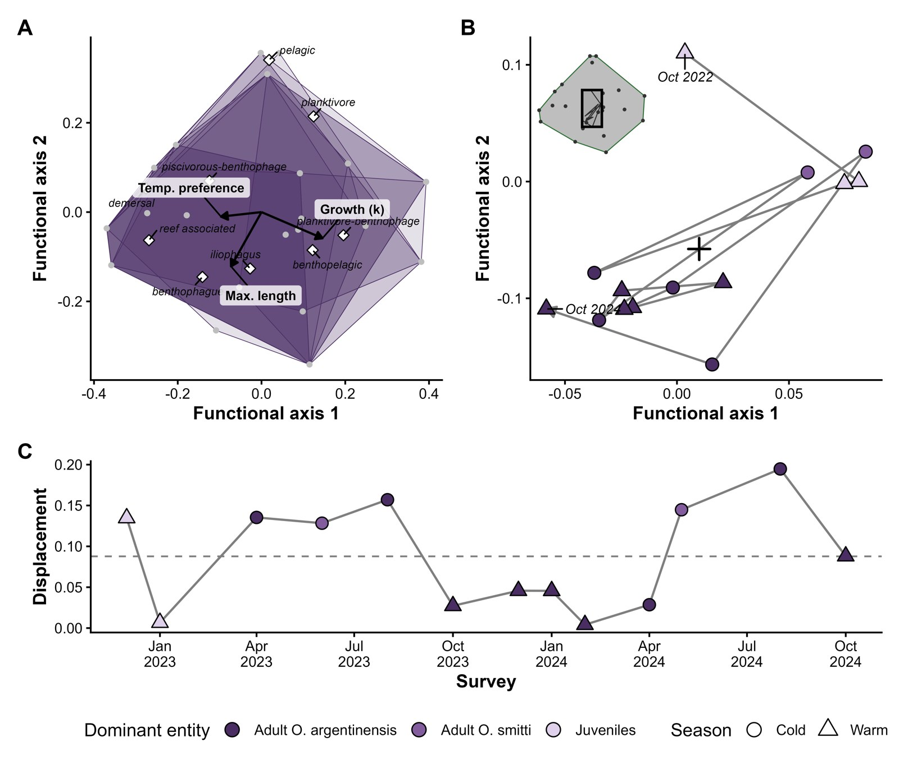{group="viz"}

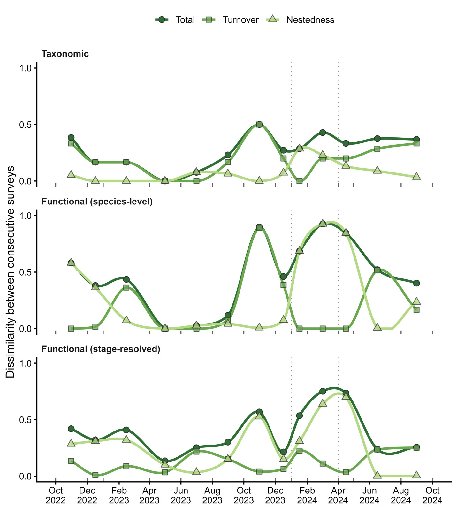{group="viz"}

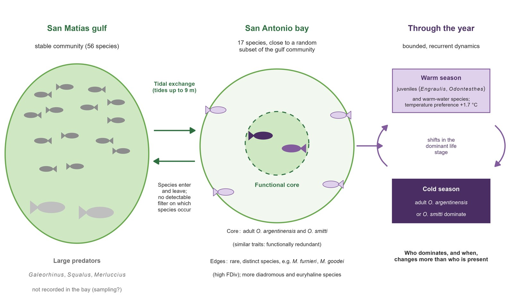{group="viz"}

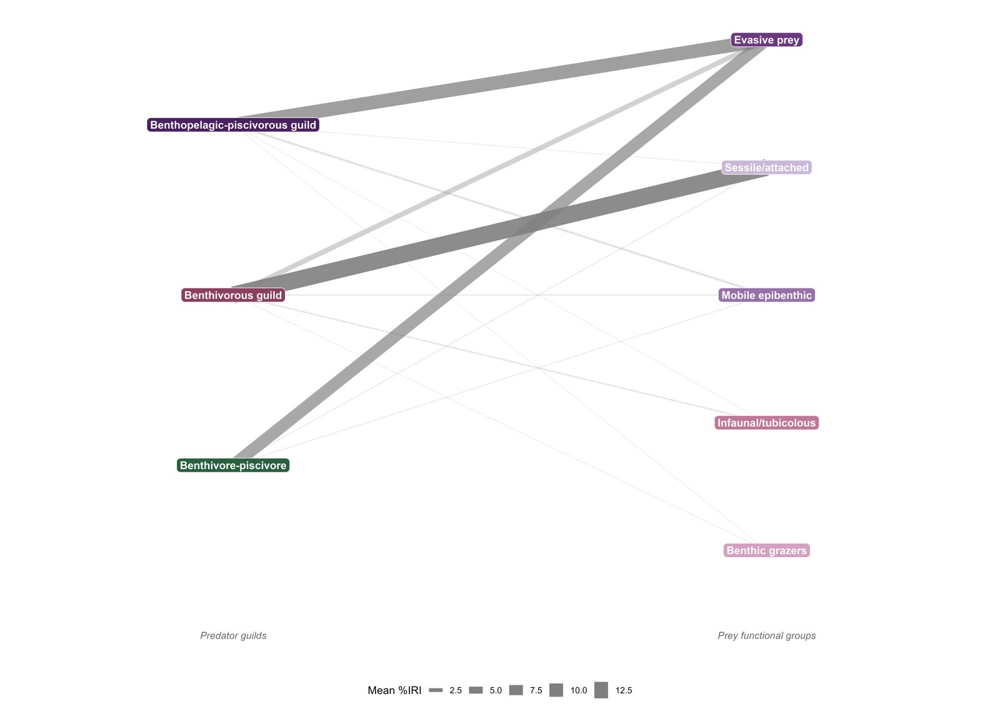{group="viz"}

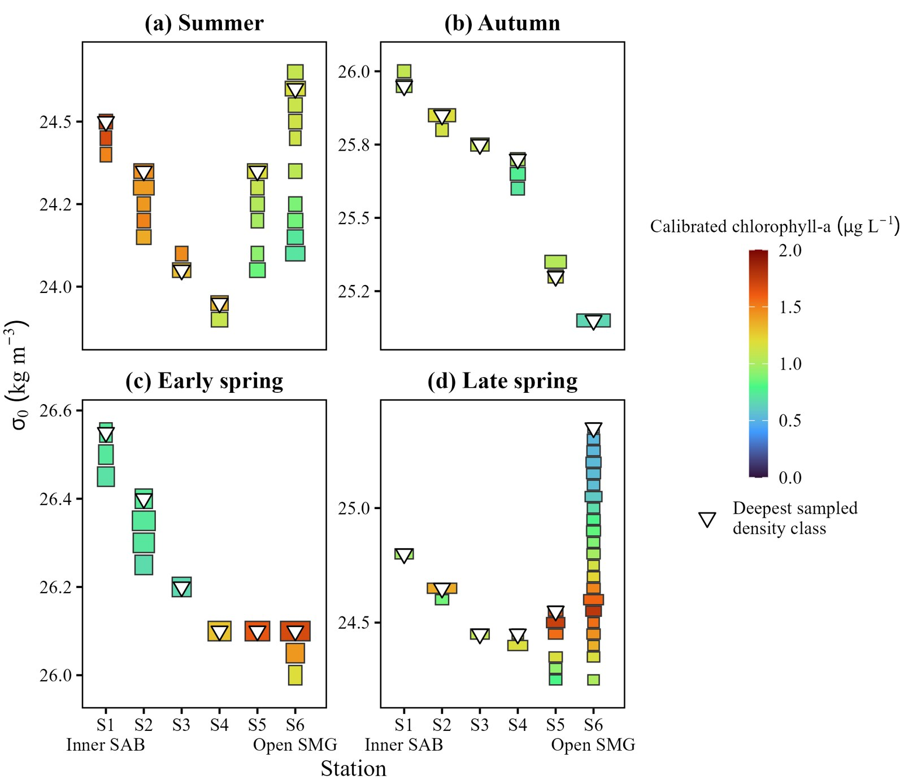{group="viz"}

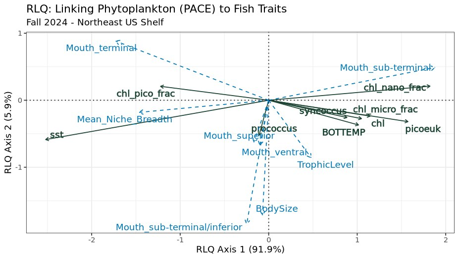{group="viz"}
:::

## From the field

These paintings are made from my own fieldwork photos in San Antonio Bay.

::: {layout-ncol=3}
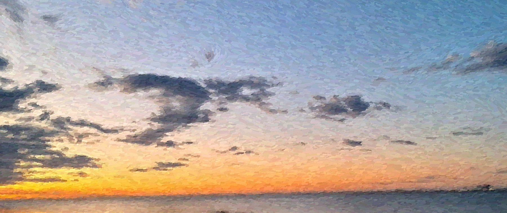{group="field"}

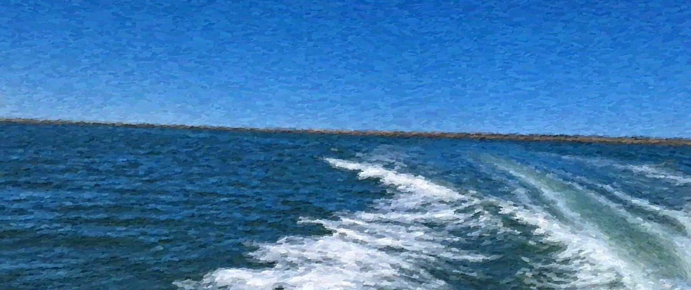{group="field"}

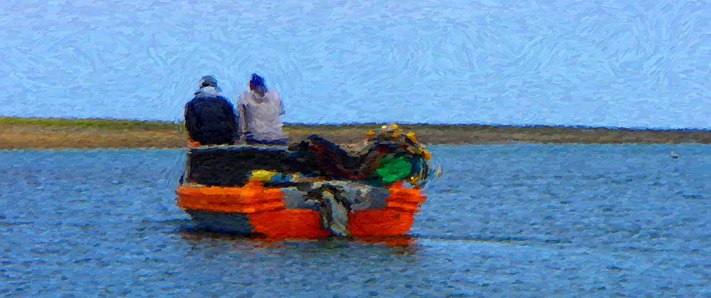{group="field"}

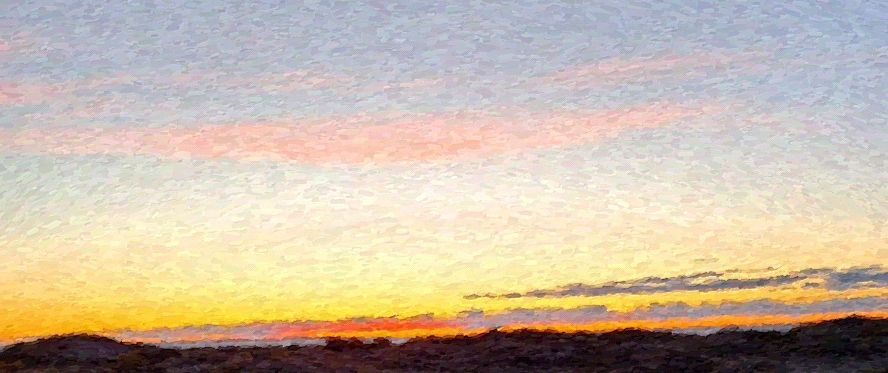{group="field"}

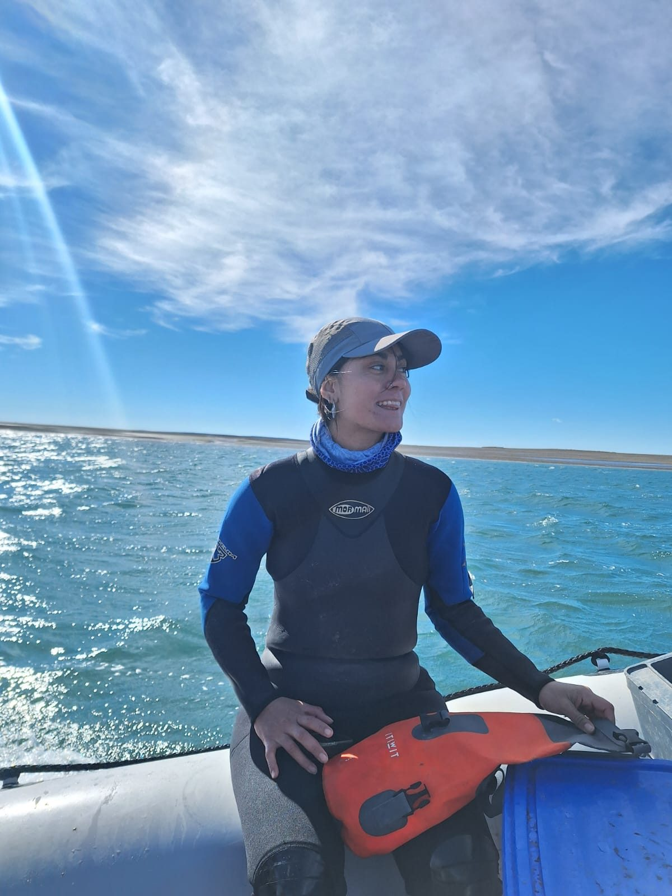{group="field"}

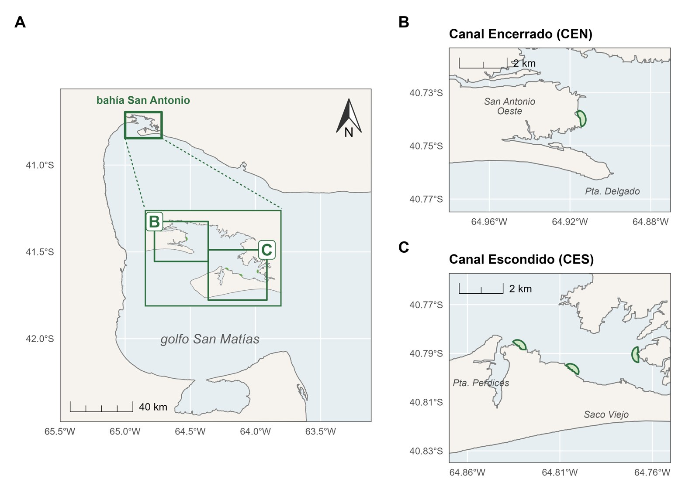{group="field"}
:::
