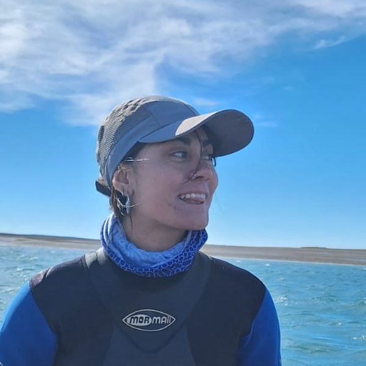
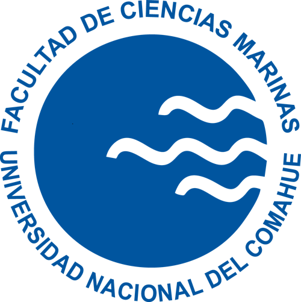
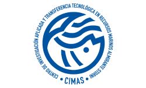
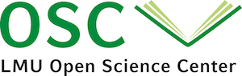
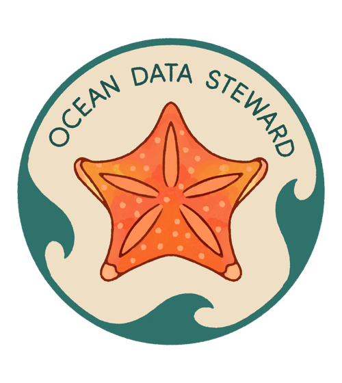
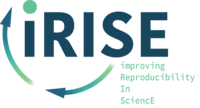
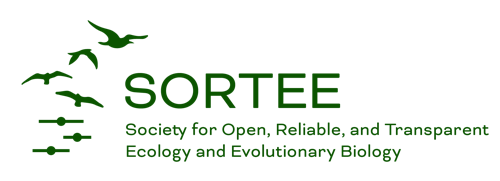
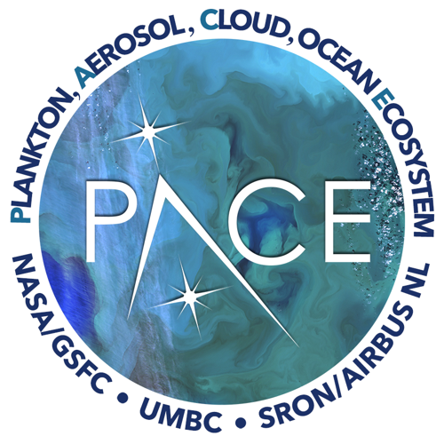

```{=html}
<section class="hero" style="background-image:url('img/bg/sunset-coast.jpg');">
  <div class="hero-inner">
    
    <h1>Maité A. Barrena</h1>
    <div class="tagline">Marine ecologist · Open science instructor · Ocean data steward</div>
    <div class="place">San Antonio Oeste, northern Patagonia, Argentina</div>
    <div class="hero-links">
      <a href="research.html">Research</a>
      <a href="cv.html">CV</a>
      <a href="https://github.com/maibarrena7">GitHub</a>
      <a href="https://www.researchgate.net/profile/Maite-Barrena-3">ResearchGate</a>
      <a href="https://www.linkedin.com/in/mait%C3%A9-barrena-706911390/">LinkedIn</a>
      <a href="mailto:maibarrena7@gmail.com">Email</a>
    </div>
  </div>
</section>
```

::: wrap

## Hi, I'm Mai 🌊

::: lead-text
I'm a marine ecologist (she/her) finishing my PhD at the National University of
Comahue and a CONICET doctoral fellow at the **Faculty of Marine Sciences** and
**CIMAS** in San Antonio Oeste, northern Patagonia.
:::

I study how coastal fish and invertebrate assemblages of **San Antonio Bay**
are assembled and how they change through time: which species and traits pass
the environmental filters of a highly variable bay, how they are connected in
food webs, and how all of this relates to the local artisanal fishery.

I also care deeply about **how** we do science. I trained as an open science
instructor at the LMU Open Science Center, I'm an Ocean Data Steward, and I'm
moving toward **metascience in marine ecology**: studying how ecological data
are collected, reported and shared, so they can be trusted and reused.

[Open to postdoctoral opportunities]{.chip .chip-open}
[Coastal community ecology]{.chip} [Functional diversity]{.chip}
[Trophic ecology]{.chip} [Artisanal fisheries]{.chip}
[Metascience]{.chip} [Reproducibility]{.chip} [FAIR data]{.chip} [R & Quarto]{.chip}

```{=html}
<div class="stats">
  <div class="stat"><div class="num">8</div><div class="lbl">papers &amp; manuscripts</div></div>
  <div class="stat"><div class="num">9</div><div class="lbl">conference presentations</div></div>
  <div class="stat"><div class="num">12</div><div class="lbl">open science trainings</div></div>
  <div class="stat"><div class="num">3</div><div class="lbl">students mentored</div></div>
</div>
```

## Where I work

```{=html}
<div class="affil">
  
  
</div>
```

<p class="centered" style="font-size:.95rem">
Laboratory of Biodiversity and Ecosystem Services (LABSE) · Faculty of Marine Sciences (FACIMAR),
National University of Comahue · CIMAS–CONICET
</p>

```{=html}
<div class="band" style="background-image:url('img/bg/fishers.jpg');">
  <div class="band-inner">
    <p>Using Patagonian coastal systems as a natural laboratory for community ecology, and ecology as a laboratory for better science.</p>
  </div>
</div>
```

## Education

```{=html}
<div class="timeline">
  <div class="tl-item">
    <div class="yr">2022 – 2027 · thesis under review</div>
    <h4>PhD in Biology</h4>
    <p>Bariloche Regional University Centre, National University of Comahue · CONICET doctoral fellowship</p>
    <p><em>Fish and invertebrate assemblages of San Antonio Bay through time: drivers of their composition, trophic ecology and artisanal fishery.</em></p>
    <p class="text-muted" style="font-size:.9rem">Supervisors: M.A. Narvarte &amp; R.A. González</p>
  </div>
  <div class="tl-item">
    <div class="yr">2012 – 2022</div>
    <h4>BSc (Licentiate, 5-year degree) in Marine Biology</h4>
    <p>Faculty of Marine Sciences, National University of Comahue</p>
    <p><em>Seasonal and ontogenetic variation in the acanthocephalan community of the Patagonian blennie (Eleginops maclovinus) in San Antonio Bay.</em></p>
    <p class="text-muted" style="font-size:.9rem">Supervisors: M.A. Narvarte &amp; J.S. Hernández-Orts</p>
  </div>
</div>
```

## Open science training

```{=html}
<div class="logo-wall">
  <a class="logo-card" href="open-science.html"><div class="lbl">Open Science Instructor Training &amp; Summer School</div><div class="yr">LMU Munich · 2026</div></a>
  <a class="logo-card" href="open-science.html"><div class="txt-logo">BIH</div><div class="lbl">Meta-Science Summer School</div><div class="yr">Berlin Institute of Health at Charité · 2026</div></a>
  <a class="logo-card" href="open-science.html"><div class="lbl">Ocean Data Stewardship Training</div><div class="yr">Intertidal Agency · 2026</div></a>
  <a class="logo-card" href="open-science.html"><div class="lbl">Train-the-Trainer: Reproducibility</div><div class="yr">iRISE · 2026</div></a>
  <a class="logo-card" href="open-science.html"><div class="lbl">Member &amp; Code Club</div><div class="yr">SORTEE · 2025 – present</div></a>
  <a class="logo-card" href="open-science.html"><div class="lbl">Fish-PACE HackWeek</div><div class="yr">NOAA Fisheries &amp; NASA PACE · 2026</div></a>
</div>
```

::: funfact
Fun fact: when I started my degree in marine biology I said
"I'm never going to work with fish, they smell bad". 🐟
:::

:::
