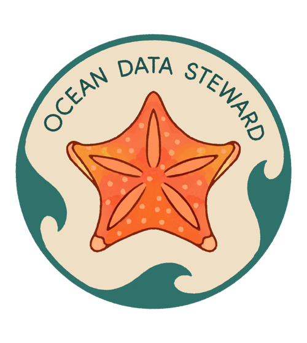
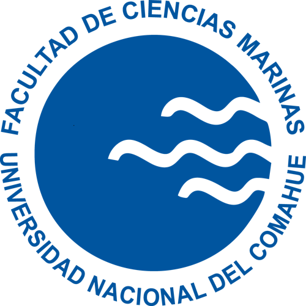
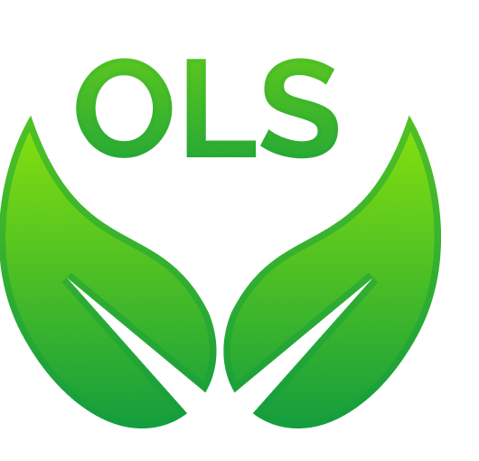
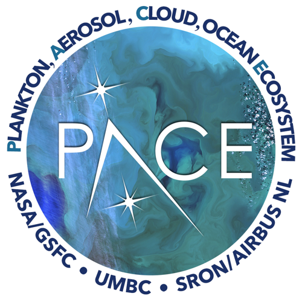
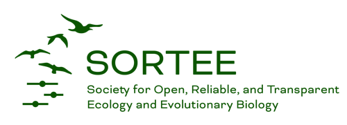

## Why it matters to me

::: split
::: {}
::: lead-text
Ecology relies more and more on long-term monitoring, satellite products and
large shared datasets. Whether those data can be trusted and reused depends on
how we organise, document and report our work.
:::

I want to help close that gap in marine ecology in two ways: by **teaching
practical, reproducible workflows** to fellow researchers, and by **studying
research practices themselves** (metascience). I'm especially interested in
data editing and data stewardship for ecological journals and observatories.
:::

{fig-alt="Ocean Data Steward sticker: an orange sea star inside a circle of waves" style="max-width:300px; box-shadow:none; display:block; margin:auto"}
:::

## Teaching: From Messy Folders to Reproducible Research

```{=html}
<div class="project">
  <div class="project-fig" style="padding:2rem">
    <br>
    
  </div>
  <div class="project-text">
    <span class="badge-status">Workshop</span><span class="meta">Faculty of Marine Sciences, UNCo · taught in Spanish</span>
    <h3>From Messy Folders to Reproducible Research: Organising Research Projects in R</h3>
    <p>A six-session, in-person workshop on organising, documenting and version-controlling research projects in R, with a simulated example project that goes from chaos to order. Developed for my instructor certification at the LMU Open Science Center. Licensed CC BY-SA 4.0.</p>
    <p><a href="https://maibarrena7.github.io/from-caos-to-order/">Workshop website</a> · <a href="https://github.com/maibarrena7/from-caos-to-order">Materials on GitHub</a></p>
  </div>
</div>
```

## Metascience

```{=html}
<div class="project flip">
  <div class="project-fig" style="padding:2rem"><div class="txt-logo" style="font-family:Fraunces,serif;font-size:2.4rem;color:#2E6F40">BIH · Charité</div><p class="meta">Meta-Science Summer School 2026<br>Travel grant awardee</p></div>
  <div class="project-text">
    <span class="badge-status review">In review</span><span class="meta">Group project · <em>Implementation Science</em></span>
    <h3>Beyond checklists: tools for study design and reporting</h3>
    <p>At the Meta-Science Summer School "Designing Studies to Improve Research" (Berlin Institute of Health at Charité), our team mapped the tools that help researchers actually implement study design and reporting guidelines, beyond the checklist itself.</p>
  </div>
</div>

<div class="project">
  <div class="project-fig" style="padding:1.5rem"></div>
  <div class="project-text">
    <span class="badge-status prep">Ongoing</span><span class="meta">Coastal Oceanographic Observatories · Río Negro node</span>
    <h3>A data protocol for a coastal observatory</h3>
    <p>Designing the structure, metadata and interoperability standards of a coastal oceanographic observatory's database, so that long-term data can be reused beyond the team that collected them.</p>
  </div>
</div>
```

## Training & communities

```{=html}
<div class="logo-wall">
  <div class="logo-card"><div class="lbl">Open Science Instructor Training (Track 2) &amp; Practical Open Science Summer School (Track 1)</div><div class="yr">LMU Munich · Sep 2026</div></div>
  <div class="logo-card"><div class="txt-logo">BIH</div><div class="lbl">Meta-Science Summer School: Designing Studies to Improve Research</div><div class="yr">Berlin Institute of Health at Charité · 2026</div></div>
  <div class="logo-card"><div class="lbl">Ocean Data Stewardship Training Program</div><div class="yr">Intertidal Agency · Spring 2026</div></div>
  <div class="logo-card"><div class="lbl">Train-the-Trainer: Introduction to Reproducibility · Preregistration &amp; preprint review</div><div class="yr">iRISE · Feb 2026</div></div>
  <div class="logo-card"><div class="lbl">Nebula Program (OLS × NASA TOPS), 4th cohort</div><div class="yr">Jul 2026</div></div>
  <div class="logo-card"><div class="txt-logo">NASA TOPS</div><div class="lbl">Open Science 101</div><div class="yr">NASA Science Mission Directorate · Jul 2026</div></div>
  <div class="logo-card"><div class="txt-logo">MetaDocencia</div><div class="lbl">Open Science Tools</div><div class="yr">Jun 2026</div></div>
  <div class="logo-card"><div class="lbl">PACE Data Access Training / Fish-PACE HackWeek (34 h)</div><div class="yr">NOAA Fisheries &amp; NASA PACE · Jan 2026</div></div>
  <div class="logo-card"><div class="lbl">Active member · Code Club · Reproducible R code webinar</div><div class="yr">SORTEE · 2025 – present</div></div>
</div>
```
