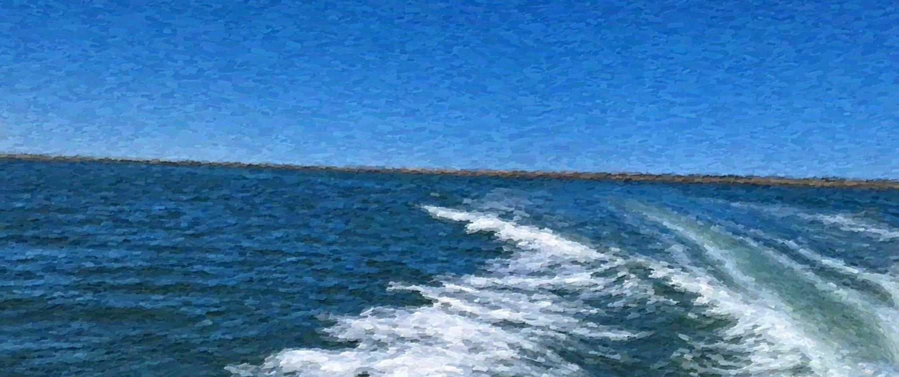

{fig-alt="Painting of a boat wake on the blue waters of San Antonio Bay"}

My PhD thesis is finally under review. After five years of trawl surveys, stomach
contents, null models and more R scripts than I'd like to admit, I'm stepping
into what I like to call the *postdoctoral wormhole*: that strange space between
finishing a thesis and figuring out what comes next.

## Where I'm coming from

My thesis looked at the fish and invertebrate assemblages of San Antonio Bay, in
northern Patagonia: which species and traits make it through the filters of a
highly variable bay, who eats whom, and how all of this connects with the local
artisanal fishery.

Along the way, I discovered a second passion: **how** we do science. Messy
folders, undocumented data, analyses nobody (including me, six months later)
could reproduce. That led me to train as an open science instructor at the LMU
Open Science Center, to join SORTEE, to become an Ocean Data Steward, and to
spend a summer thinking about study design and reporting at the Meta-Science
Summer School in Berlin.

## Where I'm going

I want to bring those two worlds together: **metascience in marine ecology**.
How are ecological data collected, reported and shared? How can we make them
easier to trust and reuse? I'm currently looking for postdoctoral opportunities
in this space.

## What you'll find here

- Notes on open science and reproducible workflows in R and Quarto
- Behind the scenes of my research in San Antonio Bay
- Reflections on research data, reporting and metascience in ecology
- The ups and downs of the postdoc search

Thanks for stopping by. 🌊
