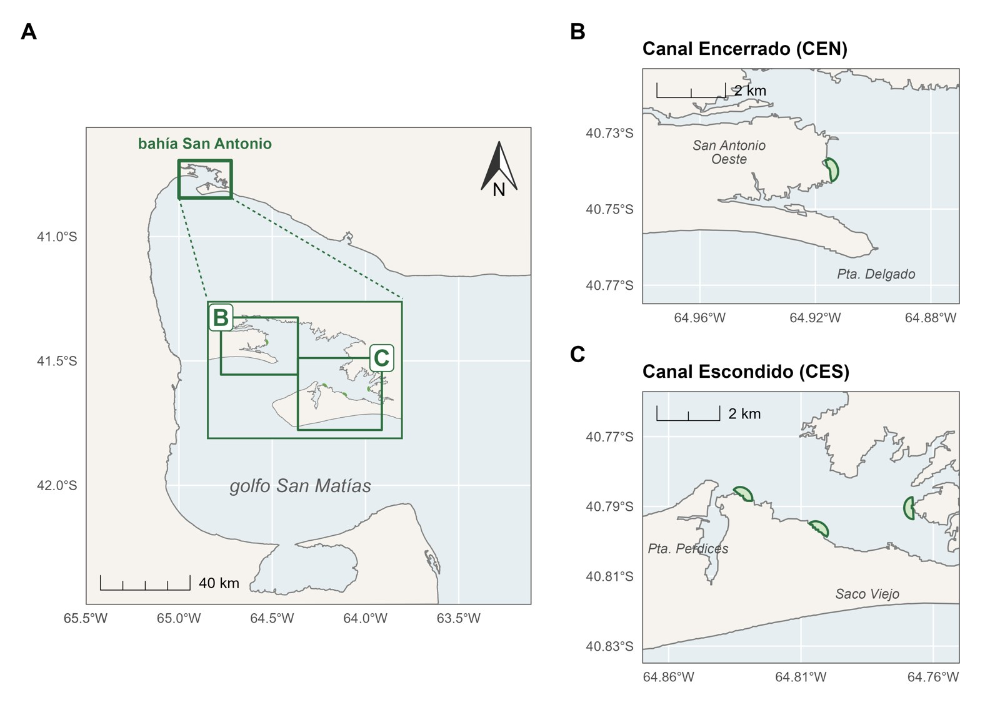
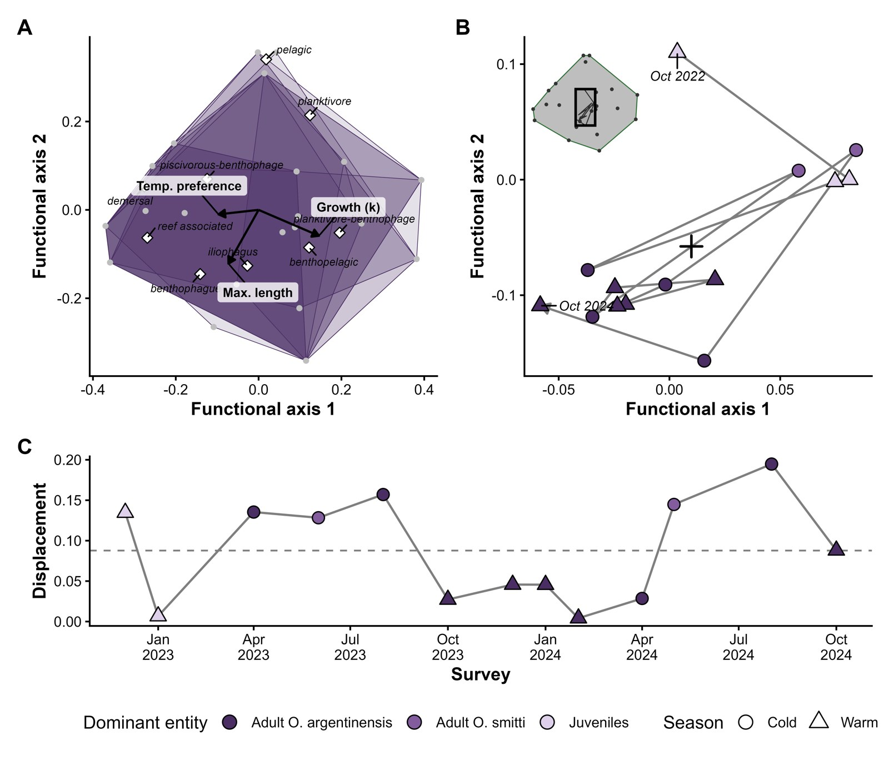
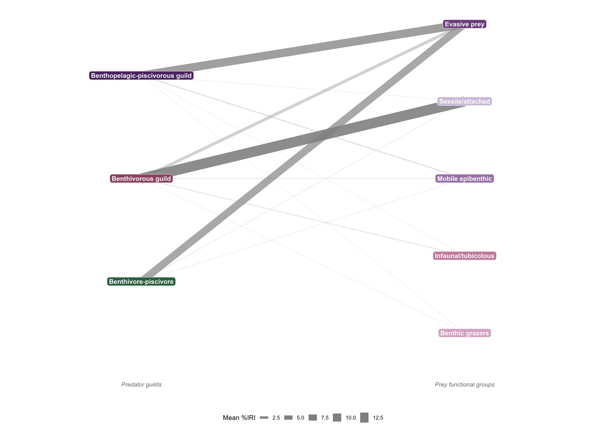
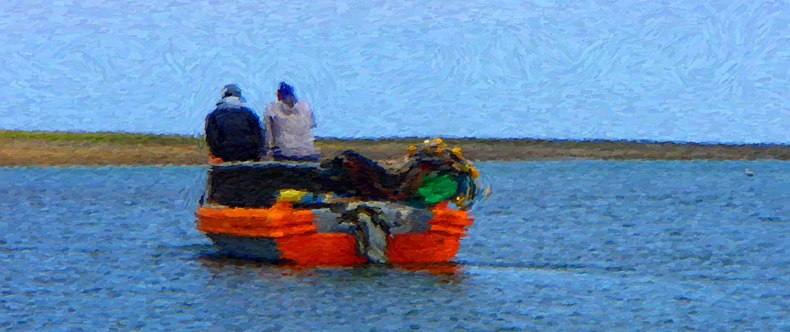
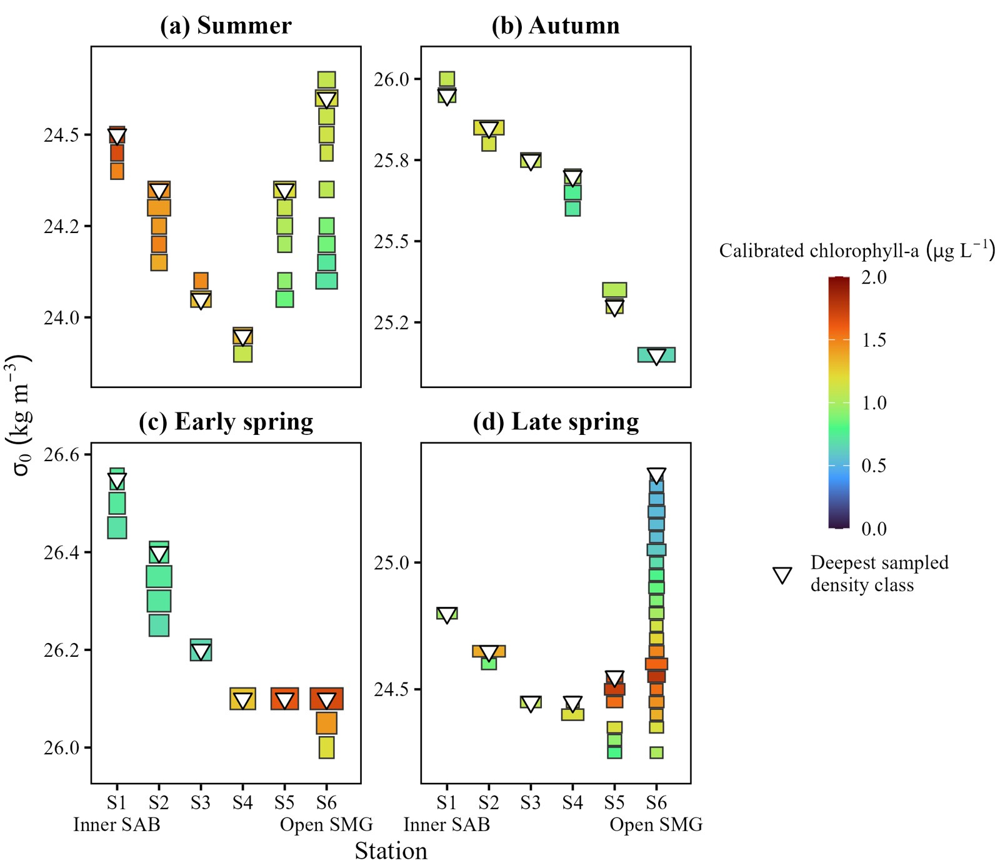
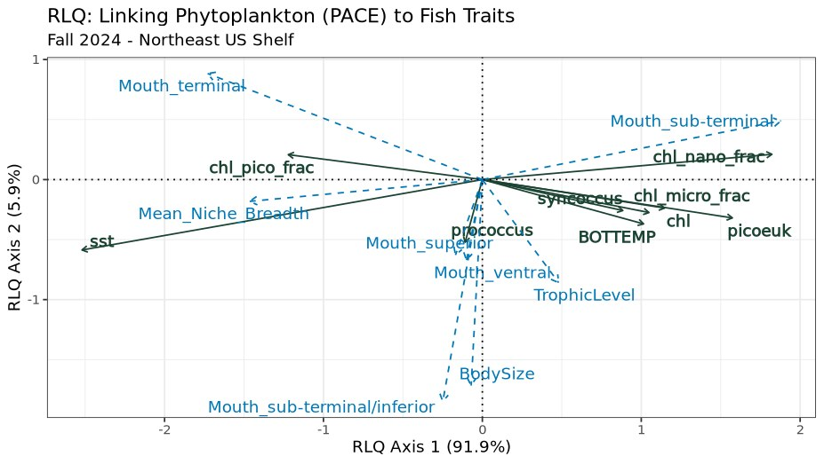

## Study system

::: split
{.lightbox}

::: {}
**San Antonio Bay** is a hypersaline, macrotidal coastal bay on the San Matías
Gulf (Río Negro, Argentina). Tides empty and refill its channels twice a day,
temperature swings strongly between seasons, and an artisanal fishery has
worked its waters for decades.

That variability makes it a natural laboratory to ask how coastal communities
are assembled, how stable they are, and how people and ecosystems are linked.

[Functional diversity]{.chip} [Community assembly]{.chip} [Food webs]{.chip}
[Fisheries]{.chip} [Oceanographic fronts]{.chip}
:::
:::

## Research lines

```{=html}
<div class="project">
  <div class="project-fig"><a href="img/figs/functional-trajectories.jpg" class="lightbox"></a></div>
  <div class="project-text">
    <span class="badge-status review">In review</span><span class="meta">PhD · chapter 1</span>
    <h3>Persistent functional structure in a variable bay</h3>
    <p>Species come and go with the seasons, yet the functional structure of the fish assemblage persists. Using null models, β-diversity and functional trajectories, we show it emerges from hierarchical environmental filtering and ontogenetic turnover.</p>
    <p class="meta">Barrena et al. · <em>Ecology and Evolution</em> (in review)</p>
  </div>
</div>

<div class="project flip">
  <div class="project-fig"><a href="img/figs/functional-network.jpg" class="lightbox"></a></div>
  <div class="project-text">
    <span class="badge-status prep">In preparation</span><span class="meta">PhD · chapter 3</span>
    <h3>Who eats whom: trophic ecology of coastal fishes</h3>
    <p>Diet analyses of the dominant coastal fishes, grouped into predator guilds and prey functional groups, reveal how the food web is organised and how opportunistic predators respond to new prey such as the invasive green crab.</p>
  </div>
</div>

<div class="project">
  <div class="project-fig"></div>
  <div class="project-text">
    <span class="badge-status">Published</span><span class="meta">PhD · chapter 4</span>
    <h3>The fish assemblage and the artisanal fishery through time</h3>
    <p>Comparing current surveys with historical records to understand how the coastal fish assemblage and the catch of San Antonio Bay's artisanal fishers have changed, and how fishers perceive those changes.</p>
    <p class="meta">Barrena et al. 2025 · <em>Marine and Fishery Sciences</em> · <a href="https://doi.org/10.47193/mafis.3842025011010">doi</a></p>
  </div>
</div>

<div class="project flip">
  <div class="project-fig"><a href="img/figs/front-chlorophyll.jpg" class="lightbox"></a></div>
  <div class="project-text">
    <span class="badge-status prep">In preparation</span><span class="meta">Collaboration · data &amp; code</span>
    <h3>A hypersaline bay–gulf front</h3>
    <p>Hydrography and chlorophyll-a patterns across the San Antonio Bay – San Matías Gulf frontal system. My role: data curation, analysis workflow and a reproducible repository.</p>
    <p class="meta">Saad et al. · <a href="https://github.com/maibarrena7/hypersaline-frontal-system">GitHub repository</a></p>
  </div>
</div>

<div class="project">
  <div class="project-fig"><a href="img/figs/pace-rlq.jpg" class="lightbox"></a></div>
  <div class="project-text">
    <span class="badge-status prep">Hackweek project</span><span class="meta">Fish-PACE HackWeek 2026</span>
    <h3>A glimpse of food webs from space</h3>
    <p>Linking satellite-derived phytoplankton functional types (NASA PACE) with fish functional traits from NOAA bottom trawl surveys on the Northeast US Shelf, using RLQ analysis.</p>
    <p class="meta"><a href="https://github.com/fish-pace/2026-proj-plankton-fish-guilds">GitHub repository</a></p>
  </div>
</div>
```

### Other lines and collaborations

::: {.grid}
::: {.g-col-12 .g-col-md-6}
::: card-item
**Plankton under marine heatwaves**

[Collaboration · *Marine Environmental Research* (in press), *Microbial Ecology* (in review)]{.meta}

How warming, recurrent heatwaves and nutrient regimes shape coastal plankton
production and respiration.
:::
:::
::: {.g-col-12 .g-col-md-6}
::: card-item
**Parasites of the Patagonian blennie**

[*Folia Parasitologica* 2025 · BSc thesis]{.meta}

Acanthocephalan fauna of *Eleginops maclovinus* and how it varies with season
and host size.
:::
:::
::: {.g-col-12 .g-col-md-6}
::: card-item
**Pacific oyster in northern Patagonia**

[*Marine and Fishery Sciences*]{.meta}

Distribution, abundance and size structure of the invasive *Magallana gigas*
along 180 km of coast.
:::
:::
::: {.g-col-12 .g-col-md-6}
::: card-item
**Research networks**

[RIDPA · μSudAqua · Arrecifes & Costas Patagonia]{.meta}

Fish Diversity Indicators Network of Argentina; Coastal Oceanographic
Observatories (Río Negro node); Patagonian coastal ecology working group.
:::
:::
:::

## Publications

```{=html}
<div class="pub">
  <span class="badge-status review">In review</span>
  <div class="pub-title">Persistent functional structure emerges from hierarchical filtering and ontogenetic turnover in a highly variable Patagonian coastal bay</div>
  <div class="pub-authors"><span class="me">Barrena M.A.</span>, Saad J.F., Svendsen G.M., Cuesta-Núñez J., Firstater F.N., Narvarte M.A., González R.A.</div>
  <div class="pub-venue">Ecology and Evolution</div>
</div>
<div class="pub">
  <span class="badge-status review">In review</span>
  <div class="pub-title">Beyond checklists: mapping tools to support study design &amp; reporting guideline implementation</div>
  <div class="pub-authors">Strzebonska K., Vachadze N., <span class="me">Barrena M.A.</span>, Kaur S., Khanal R., Nemeti-Feher Z., Sancar I.V., Wojciechowska M., Zhao X., Nachev V., Weissgerber T.L.</div>
  <div class="pub-venue">Implementation Science</div>
</div>
<div class="pub">
  <span class="badge-status review">In review</span>
  <div class="pub-title">Nutrient regimes shape coastal plankton responses to marine heatwaves, warming, and low nitrogen-to-phosphorus ratios</div>
  <div class="pub-authors">Cabrerizo M.J., Helbling E.W., Valiñas M.S., Saad J.F., Unrein F., <span class="me">Barrena M.A.</span>, Villafañe V.E.</div>
  <div class="pub-venue">Microbial Ecology</div>
</div>
<div class="pub">
  <span class="badge-status press">In press</span>
  <div class="pub-title">Recurrent heatwaves, warming and a low nitrogen-to-phosphorus ratio stimulate the gross primary production-to-respiration ratios in coastal plankton</div>
  <div class="pub-authors">Cabrerizo M.J., Helbling E.W., Valiñas M.S., Unrein F., Saad J.F., <span class="me">Barrena M.A.</span>, Irigoyen M.F., Villafañe V.E.</div>
  <div class="pub-venue">Marine Environmental Research</div>
</div>
<div class="pub">
  <span class="badge-status">2025</span>
  <div class="pub-title">Thorny-headed worms (Acanthocephala) of the Patagonian blennie <em>Eleginops maclovinus</em> (Cuvier) from northern Patagonia, Argentina</div>
  <div class="pub-authors"><span class="me">Barrena M.A.</span> &amp; Hernández-Orts J.S.</div>
  <div class="pub-venue">Folia Parasitologica 72: 030 · <a href="https://doi.org/10.14411/fp.2025.030">doi:10.14411/fp.2025.030</a></div>
</div>
<div class="pub">
  <span class="badge-status">2025</span>
  <div class="pub-title">A historical appraisal of fish assemblage and the artisanal fishery in San Antonio Bay, northern Patagonia, Argentina</div>
  <div class="pub-authors"><span class="me">Barrena M.A.</span>, Saad J.F., Gastaldi M., Landete D., Firstater F.N., Narvarte M.A., González R.A.</div>
  <div class="pub-venue">Marine and Fishery Sciences 38(4) · <a href="https://doi.org/10.47193/mafis.3842025011010">doi:10.47193/mafis.3842025011010</a></div>
</div>
<div class="pub">
  <span class="badge-status">2025</span>
  <div class="pub-title">Distribution, abundance and size structure of the Pacific oyster <em>Magallana gigas</em> in northern Patagonia <span style="font-weight:400">(in Spanish)</span></div>
  <div class="pub-authors">Hünicken L.A., González R., Landete D., <span class="me">Barrena M.A.</span>, Saad J.F., Narvarte M.A.</div>
  <div class="pub-venue">Marine and Fishery Sciences · <a href="https://doi.org/10.47193/mafis.3822025010105">doi:10.47193/mafis.3822025010105</a></div>
</div>
<div class="pub">
  <span class="badge-status">2024</span>
  <div class="pub-title">A Latin American network of microbial observatories for monitoring aquatic ecosystems</div>
  <div class="pub-authors">Fermani P., Martyniuk N., Saraceno M., Gerea M., Sabio y García C.A., Schiaffino M.R., Sánchez M.L., Dohle S.A., Alonso C., <span class="me">Barrena M.A.</span>, et al.</div>
  <div class="pub-venue">Ecología Austral · <a href="https://doi.org/10.25260/EA.24.34.3.0.2436">doi:10.25260/EA.24.34.3.0.2436</a></div>
</div>
```
