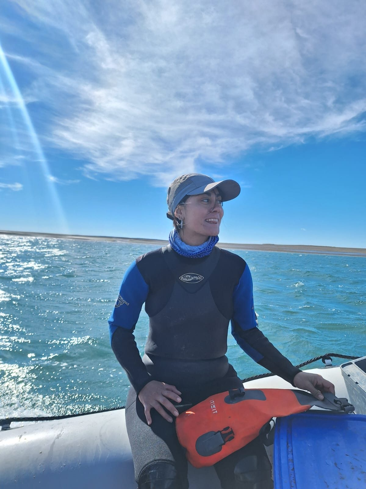

## University teaching

```{=html}
<div class="timeline">
  <div class="tl-item">
    <div class="yr">2024 – present</div>
    <h4>Teaching Assistant · Mathematics I</h4>
    <p>BSc in Marine Biology, Faculty of Marine Sciences, UNCo</p>
    <p>I prepare step-by-step worked solutions to exams so students can follow the reasoning, not just the answer.</p>
  </div>
  <div class="tl-item">
    <div class="yr">2016 – 2018</div>
    <h4>Student Teaching Assistant · History and Philosophy of Science</h4>
    <p>BSc in Marine Biology, Faculty of Marine Sciences, UNCo</p>
  </div>
  <div class="tl-item">
    <div class="yr">2016</div>
    <h4>Student Teaching Assistant · Invertebrates I</h4>
    <p>BSc in Marine Biology, Faculty of Marine Sciences, UNCo</p>
  </div>
</div>
```

## Mentoring

::: {.grid}
::: {.g-col-12 .g-col-md-6}
::: card-item
**BSc thesis co-supervision · Lautaro Escobar Molina**

[2026 – present · with Dr. E. Rodríguez]{.meta}

How aggregates of the ecosystem-engineer polychaete *Phyllochaetopterus* spp.
shape macrozoobenthic assemblages along a regional gradient of rocky
intertidal shores in the San Matías Gulf.
:::
:::
::: {.g-col-12 .g-col-md-6}
::: card-item
**BSc thesis co-supervision · Valentina L. Martín**

[2025 – present · with Dr. L.A. Hünicken]{.meta}

Updating the diet of three dominant coastal fishes of San Antonio Bay:
*E. maclovinus*, *O. argentinensis* and *D. argenteus*.
:::
:::
:::

::: card-item
**Supervised research practicums (PInEX)** · Laboratory of Biodiversity and Ecosystem Services

[2023 – 2026 · G. Vásquez, V. Martín, L. Escobar Molina]{.meta}

Training students to identify and analyse epibenthic assemblages from
artisanal fishing grounds and benthic fauna associated with polychaete
aggregates.
:::

## Open science teaching

::: card-item
**From Messy Folders to Reproducible Research** · six-session workshop on organising research projects in R

[Faculty of Marine Sciences, UNCo]{.meta}

See [Open Science](open-science.qmd) ·
[workshop website](https://maibarrena7.github.io/from-caos-to-order/)
:::

## Outreach

```{=html}
<div class="split">
  
  <div>
    <div class="card-item"><strong>"Beauty is on the inside": the ecological importance of parasites on Patagonian coasts</strong><p class="meta">Talk · World Oceans Week 2024, FACIMAR</p></div>
    <div class="card-item"><strong>Arrecifes &amp; Costas Patagonia</strong><p class="meta">Talk · World Oceans Week 2024, FACIMAR</p></div>
    <div class="card-item"><strong>"Algae: the little giants of San Antonio Bay"</strong> and <strong>"Mathematics in Action"</strong><p class="meta">University outreach projects, FACIMAR–UNCo</p></div>
    <div class="card-item"><strong>World Oceans Day open house</strong><p class="meta">CIMAS · 2023</p></div>
  </div>
</div>
```
